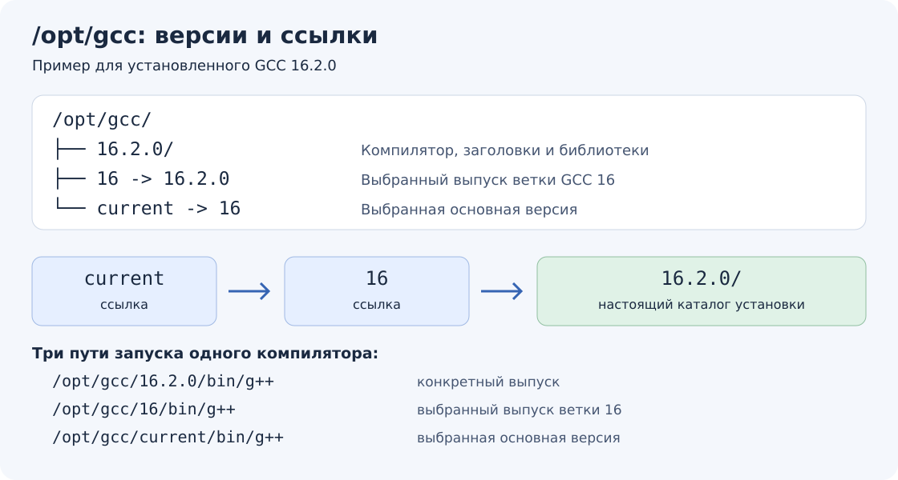

# Ubuntu 22.04: GCC 16 отдельно от системного компилятора

Сборка GCC 16.2.0 на Ubuntu 22.04 x86-64 отдельно от системного GCC 11.

## Размещение и место

Исходники и временную сборку GCC разместите в домашнем разделе `/home`,
а готовый компилятор установите в `/opt/gcc/16.2.0`. На разделе с `/opt` потребуется
место для готовой установки; команды ниже также направляют временные файлы
через `TMPDIR` в `/home`, поскольку `/tmp` может находиться на системном разделе.
После установки исходники и каталог сборки можно удалить отдельно.
Удаление каталога установки удалит сам компилятор и его библиотеки.

Каждый выпуск устанавливается в отдельный каталог с полным номером версии.
Ссылки `16` и `current` выбирают выпуск ветки GCC 16 и основную версию
соответственно. Эта организация подходит для разных проектов:

```text
/opt/gcc/
├── 16.2.0/          ← компилятор, заголовки и библиотеки этого выпуска
├── 16 -> 16.2.0    ← выбранный выпуск GCC 16
└── current -> 16   ← выбранная основная версия
```



`/opt/gcc` — обычный каталог. Символическая ссылка хранит путь к другому
файлу или каталогу; содержимое компилятора не копируется. Например,
`/opt/gcc/current/bin/g++` при такой схеме обращается к
`/opt/gcc/16.2.0/bin/g++`. Имя `current` означает выбранную пользователем
версию, а не автоматически самый новый выпуск.

Проверьте оба раздела:

```bash
df -h "$HOME" /opt
```

Временная сборка существенно больше готовой установки. Точный размер зависит
от параметров, отладочных данных и bootstrap; оставьте запас и следите за
свободным местом. Число параллельных процессов ограничивается также памятью.
Пример ниже использует шесть процессов и `bootstrap-lean`, удаляющий ненужные
промежуточные стадии. На машине с меньшим объёмом памяти уменьшите `-j6`.

## Зависимости и исходники

Системный GCC 11 достаточно новый для сборки C/C++-части GCC 16. Он остаётся
системным компилятором. Для сборки используются `build-essential`, `curl`, `wget`,
`xz-utils`, `bzip2`, `m4`, `perl`, `zlib1g-dev` и `flex`. Для неизменённого
архива выпуска не требуется пересоздавать готовую документацию и парсеры
с помощью `texinfo` и `bison`.
При отсутствии `makeinfo` пропускается генерация части справки Info.

В командах ниже `flex` извлекается из пакета Ubuntu в отдельный каталог.
GMP, MPFR, MPC, ISL и gettext скачиваются официальным скриптом
и собираются вместе с GCC:

```bash
mkdir -p "$HOME/src" "$HOME/build/gcc-16.2.0" \
    "$HOME/build/gcc-16-tools" "$HOME/tmp/gcc-16.2.0"
export TMPDIR="$HOME/tmp/gcc-16.2.0"

cd "$HOME/build/gcc-16-tools"
apt-get download flex=2.6.4-8build2
dpkg-deb -x flex_2.6.4-8build2_amd64.deb .
export PATH="$HOME/build/gcc-16-tools/usr/bin:/usr/bin:/bin"
flex --version

cd "$HOME/src"
curl --fail --location \
    https://sourceware.org/pub/gcc/releases/gcc-16.2.0/gcc-16.2.0.tar.xz \
    --output gcc-16.2.0.tar.xz
curl --fail --location \
    https://sourceware.org/pub/gcc/releases/gcc-16.2.0/sha512.sum \
    --output gcc-16.2.0.sha512.sum
sha512sum --check --ignore-missing gcc-16.2.0.sha512.sum
tar -xf gcc-16.2.0.tar.xz

cd "$HOME/src/gcc-16.2.0"
./contrib/download_prerequisites
```

Каталог сборки должен быть отдельным от исходников и установки. При повторной
сборке с другими параметрами используйте новый пустой каталог сборки.
`download_prerequisites` проверяет SHA-512 зависимостей по перечню из выпуска GCC.
Настройки `PATH` и `TMPDIR` действуют только в текущей оболочке; в файлы
профиля их добавлять не нужно. Путь к новому GCC в глобальный `PATH` не добавляется.

## Сборка и установка

```bash
cd "$HOME/build/gcc-16.2.0"
export CFLAGS='-O2 -g0'
export CXXFLAGS='-O2 -g0'
export CFLAGS_FOR_TARGET='-O2 -g0'
export CXXFLAGS_FOR_TARGET='-O2 -g0'
"$HOME/src/gcc-16.2.0/configure" \
    --prefix=/opt/gcc/16.2.0 \
    --enable-languages=c,c++ \
    --disable-multilib \
    --enable-checking=release \
    --with-system-zlib

make -j6 BOOT_CFLAGS='-O2 -g0' \
    CFLAGS_FOR_TARGET='-O2 -g0' CXXFLAGS_FOR_TARGET='-O2 -g0' bootstrap-lean

# Для новой отдельной установки: создать каталог с владельцем текущего пользователя.
sudo install -d -m 755 /opt/gcc
sudo install -d -m 755 -o "$USER" -g "$(id -gn)" /opt/gcc/16.2.0
make install-strip

sudo ln -sTf 16.2.0 /opt/gcc/16
sudo ln -sTf 16 /opt/gcc/current

/opt/gcc/16/bin/g++ --version
/usr/bin/g++ --version
```

`--enable-languages` ограничивает набор языков, `--disable-multilib` исключает
дополнительные 32-битные варианты. Bootstrap проверяет сборку компилятором самого
себя и сравнивает вторую и третью стадии; `bootstrap-lean` удаляет предыдущие
стадии, когда они больше не нужны. `-g0` сокращает отладочные данные самого GCC
и его библиотек, `install-strip` удаляет ненужные символы из установки.
Это не мешает собирать учебные программы с `-g` и отлаживать их через GDB.

`sudo` нужен для создания каталога в `/opt`; конфигурация, сборка и установка
в принадлежащий пользователю каталог выполняются без прав администратора.
Системные `/usr/bin/gcc`, `/usr/bin/g++`, библиотеки и `update-alternatives`
при этом не меняются. Официальные подробности: [требования](https://gcc.gnu.org/install/prerequisites.html),
[конфигурация](https://gcc.gnu.org/install/configure.html),
[сборка](https://gcc.gnu.org/install/build.html),
[зависимости из исходников](https://gcc.gnu.org/install/download.html).

## Выбор и переключение версий

| Путь к компилятору | Что выбирает |
|---|---|
| `/opt/gcc/16.2.0/bin/g++` | Конкретный установленный выпуск |
| `/opt/gcc/16/bin/g++` | Выбранный выпуск ветки GCC 16 |
| `/opt/gcc/current/bin/g++` | Выбранную основную версию, в том числе другую ветку |

В настройках IDE или системы сборки указывайте нужный путь к `gcc` и `g++`.
Для воспроизводимой сборки закрепляйте полный номер версии; путь через `16`
позволяет обновлять выпуск внутри ветки. Для ручного выбора основной версии
удобен `current`. Системный `/usr/bin/g++` при этом остаётся прежним.

Создать или заменить ссылки для уже установленного GCC 16.2.0:

```bash
sudo ln -sTf 16.2.0 /opt/gcc/16
sudo ln -sTf 16 /opt/gcc/current
```

`ln` — сокращение от английского *link* («ссылка»). Ключ `-s`
(`--symbolic`) создаёт символическую ссылку; `-f` (`--force`) разрешает
замену существующей ссылки. `-T` (`--no-target-directory`) трактует последний
аргумент как имя самой ссылки, а не каталог для её размещения. Регистр важен:
`-t` (`--target-directory`) имеет другое назначение. Короткие ключи объединены
в `-sTf`. Относительный путь `16.2.0` отсчитывается от каталога ссылки,
то есть от `/opt/gcc`, а не от текущего каталога терминала.

Следующий пример предполагает, что другой GCC уже установлен и путь
`/opt/gcc/17/bin/g++` существует. Команда не скачивает и не устанавливает GCC 17:

```bash
test -x /opt/gcc/17/bin/g++ && sudo ln -sTf 17 /opt/gcc/current
```

Вернуться к GCC 16:

```bash
test -x /opt/gcc/16/bin/g++ && sudo ln -sTf 16 /opt/gcc/current
```

Узнать выбранный каталог и фактическую версию:

```bash
readlink /opt/gcc/current
readlink -f /opt/gcc/current
/opt/gcc/current/bin/g++ --version
```

Первая команда показывает содержимое ссылки, например `16`; вторая разрешает
всю цепочку и показывает `/opt/gcc/16.2.0`; третья запускает компилятор.
После установки нового выпуска ветки создавайте ссылку `16` на его полный
номер, сохраняя прежний каталог для возврата. Например, для условного будущего
выпуска 16.3.0 команда выполняется только после его установки:

```bash
test -x /opt/gcc/16.3.0/bin/g++ && sudo ln -sTf 16.3.0 /opt/gcc/16
```

Для возврата к сохранённому выпуску:

```bash
test -x /opt/gcc/16.2.0/bin/g++ && sudo ln -sTf 16.2.0 /opt/gcc/16
```

Если `current -> 16`, он последует за изменением ссылки ветки. Ссылка на
полный номер, например `current -> 16.2.0`, закрепила бы именно этот выпуск.
Переключать ссылки следует между сборками; после смены компилятора выполняйте
чистую сборку в отдельном каталоге.
Ссылки не переключают уже запущенные процессы и не пересобирают готовые программы.

Готовой программе компилятор для запуска не нужен, но может потребоваться
`libstdc++` из его установки. Общие скрипты этого проекта разрешают ссылки
перед записью `rpath`, закрепляя библиотеки за полным номером версии.
Поэтому сохраняйте каталог выпуска, пока его библиотеки нужны собранным
программам.

Окончательный `--prefix` выбирайте перед сборкой. Одного перемещения готового
каталога недостаточно для полной независимости от прежнего пути: в GCC может
остаться вшитый каталог переводов диагностик, а в его библиотеках — старый
`rpath`. При смене места установки соберите GCC в новом каталоге с правильным
`--prefix`, затем пересоберите использующие его программы с новыми `rpath`.
Проверьте также служебные файлы с абсолютными путями: метаданные Libtool
(`*.la`) и настройку Python pretty-printers GDB (`*-gdb.py`, форматирование
типов при отладке). Переключение ссылок `16` и `current` не переносит сами
каталоги выпусков и не требует пересборки GCC.
Перезапуск ОС для смены ссылки не требуется.
[Описание GNU ln](https://www.gnu.org/software/coreutils/manual/html_node/ln-invocation.html).

## Выбор компилятора и запуск

Вернитесь в корень этого репозитория:

```bash
export CXX_MODERN=/opt/gcc/16/bin/g++
bash scripts/build-linux.sh additions/reflection/06-toolchain/main.cpp
./build/additions/reflection/06-toolchain/main
ldd ./build/additions/reflection/06-toolchain/main

bash scripts/generate-compile-commands.sh
```

Пример [проверки возможностей компилятора](06-toolchain/README.md) должен
вывести `reflection enabled; GCC 16` и `OK 06-toolchain`, затем завершиться
с кодом `0`. В выводе `ldd` не должно быть `not found`;
`libstdc++.so.6` должна находиться внутри `/opt/gcc/16.2.0`.

Общий `build-linux.sh` определяет каталог `libstdc++.so.6` через выбранный `g++`
и разрешает символические ссылки перед записью `rpath` в исполняемый файл.
Поэтому программа находит библиотеку
установленного GCC. Расположение `lib` или `lib64` определяет сам компилятор.
Генератор IntelliSense использует `CXX_MODERN` для современных уроков;
после смены компилятора или зависимостей запускайте его заново.

Если сам `/opt/gcc/16/bin/g++` не запускается из-за библиотек, сначала
проверьте его `ldd`. Временную настройку поиска делайте только для этого запуска
или отдельного терминала; не заменяйте системные `libstdc++` и не создавайте на них
глобальные симлинки. Настройка `rpath` приложения не исправляет зависимости
исполняемого файла самого компилятора. [Поиск libstdc++](https://gcc.gnu.org/onlinedocs/libstdc++/manual/using_dynamic_or_shared.html).

[Скрипты сборки и автоматических проверок](../../scripts/README.md) ·
[К урокам рефлексии](README.md).
